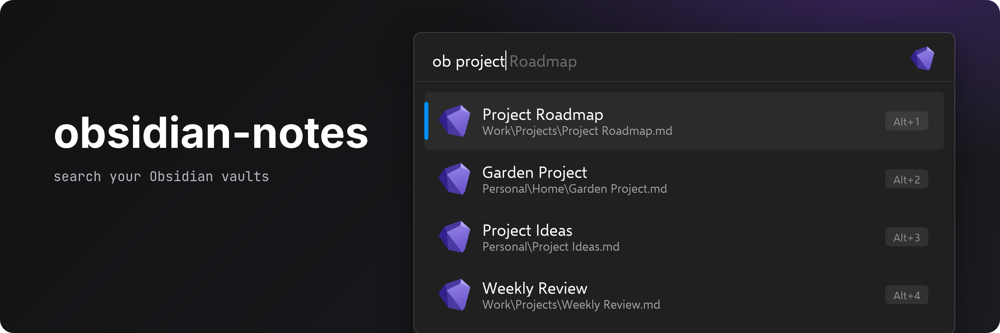

<!-- generated by readwright from docs/README.md.j2; edit the template, not this file -->


# Obsidian Notes

Search the notes in your Obsidian vaults from Flow Launcher and open them in Obsidian.

[](https://github.com/Garulf/Obsidian-Notes/actions/workflows/tests.yml) [](https://github.com/Garulf/Obsidian-Notes/releases/latest) [](https://github.com/Garulf/Obsidian-Notes/releases/latest)

[](https://www.buymeacoffee.com/garulf) [](https://github.com/sponsors/Garulf)

## Features

* **Every vault at once.** Finds your vaults from Obsidian's own settings. Nothing to configure.
* **Title or path.** Matches note titles and the folders they live in.
* **Opens in Obsidian.** `Enter` opens the note in the right vault.
* **Checklists.** `Shift+Enter` lists a note's checkboxes. Select one to tick it off.

## Usage

Type `ob` followed by part of a note's title or path, then press `Enter` to open it in Obsidian:

```
ob project
```


### Checklists

Open the context menu (`Shift+Enter` or right-click) on a note to see its `- [ ]` checkboxes,
grouped under the line that introduces them. Select an item to check or uncheck it in the note:


## Installation

### Flow Launcher

In Flow Launcher, type:

```
pm install obsidian notes
```


### Manual installation

Download `Obsidian-Notes-<version>.zip` from the [latest release](https://github.com/Garulf/Obsidian-Notes/releases/latest) and unzip it into
`%appdata%\FlowLauncher\Plugins`, then restart Flow Launcher.

Pre-releases of the next version are published from the open release PR on the
[releases page](https://github.com/Garulf/Obsidian-Notes/releases) for testing. Flow Launcher won't offer them as updates.

## Requirements

* [Obsidian](https://obsidian.md) desktop app, with at least one vault opened
* Flow Launcher 1.17.0 or newer
* Python 3.8 or newer, which Flow Launcher can install for you

## Changelog

See [CHANGELOG.md](CHANGELOG.md) for the full history.
